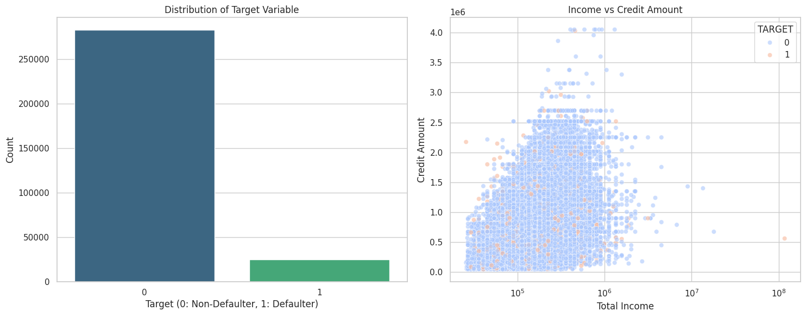
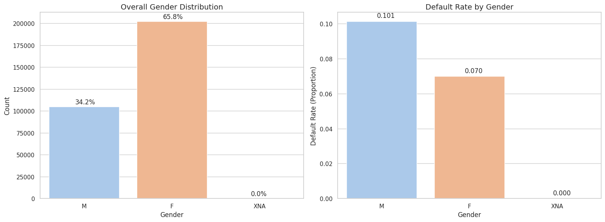
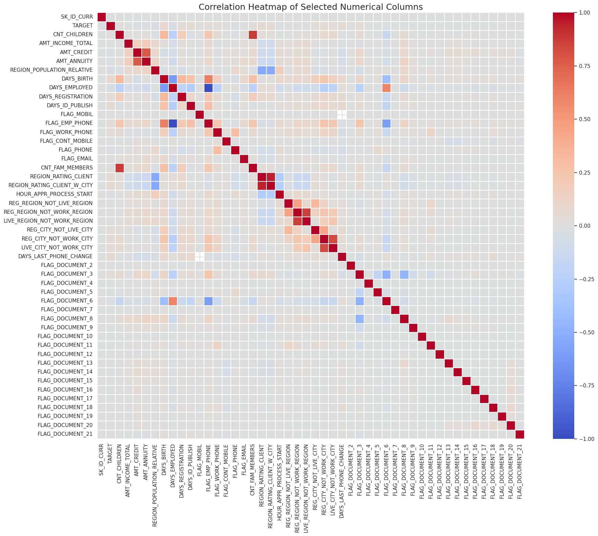
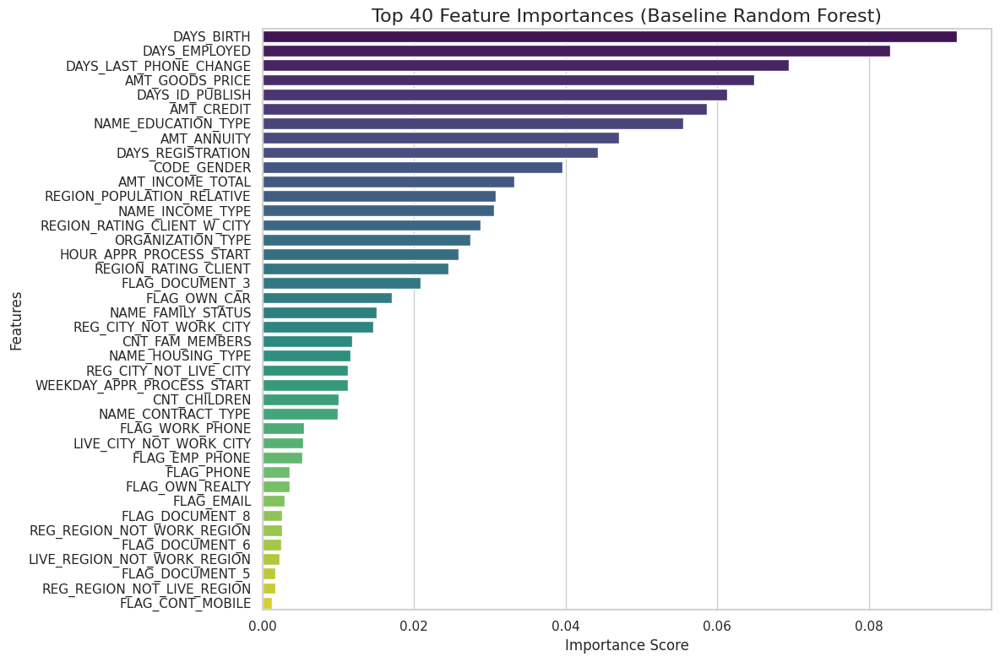
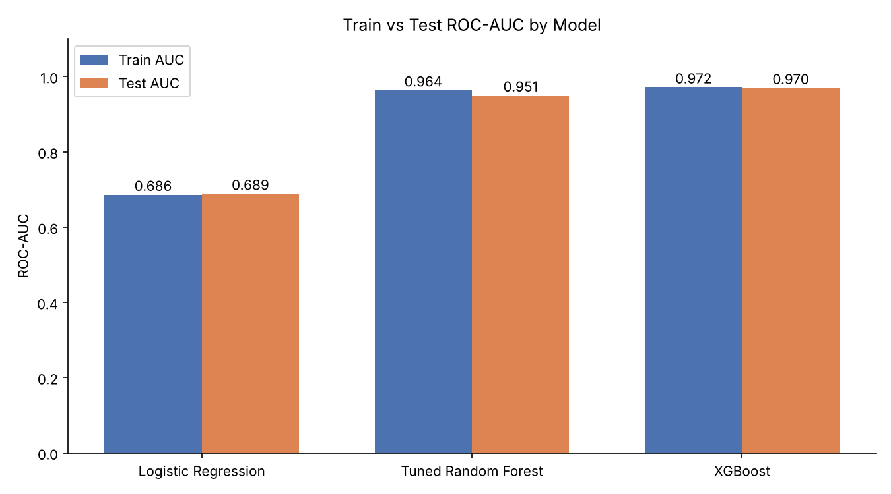
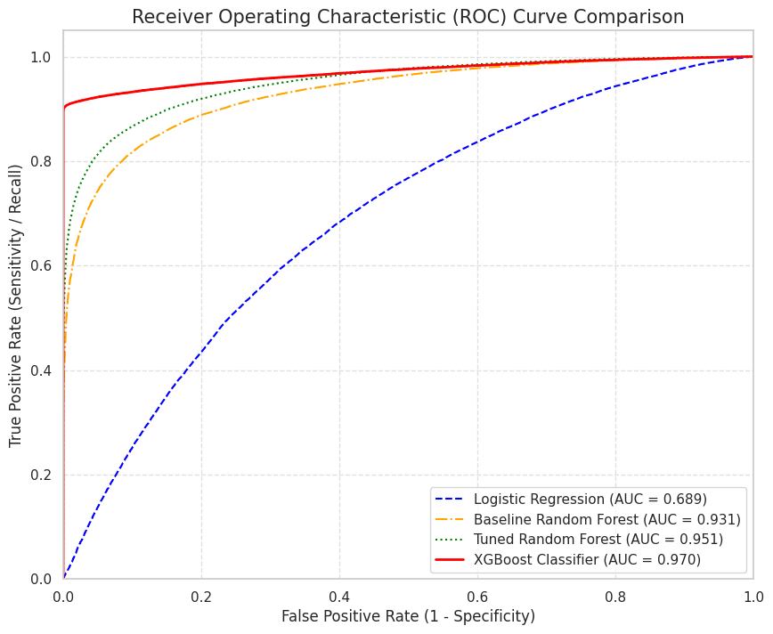
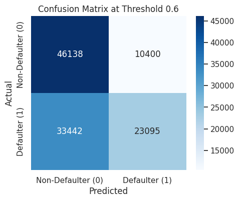
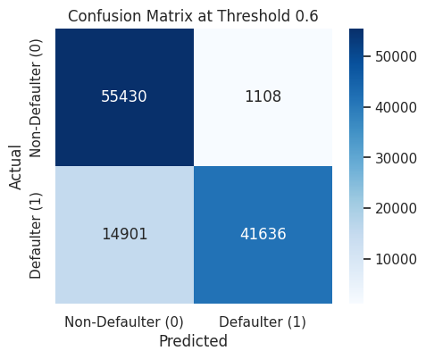
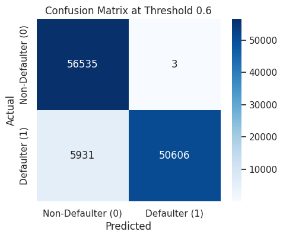

# 🏦 Credit Card fraud detection.

> An End-to-End Approach to Transaction Classification, Model Evaluation, and Fraud Risk Assessment, using 307,511 applications from the Home Credit dataset.


---

## 📌 Table of Contents
1. [Business Problem](#-business-problem)
2. [Dataset](#-dataset)
3. [Workflow](#-workflow)
4. [Exploratory Data Analysis](#-exploratory-data-analysis)
5. [Feature Importance](#-feature-importance)
6. [Modelling & Results](#-modelling--results)
7. [Limitations & Next Steps](#%EF%B8%8F-limitations--next-steps)
8. [How to Run](#-how-to-run)

---

## 🎯 Business Problem
The primary business problem is to develop a machine learning-based binary classification system that distinguishes legitimate transactions from fraudulent transactions using relevant transaction features. The model will classify each transaction as legitimate (Class 0) or fraudulent (Class 1).

## 📊 Dataset
| Item | Value |
|---|---|
| Source | Home Credit `application_data.csv` |
| Rows × Columns | 307,511 × 122 |
| Target | `TARGET`  |
| Class balance | **91.9 % non-default / 8.1 % default** (highly imbalanced) |
| Duplicates | 0 |

## 🔄 Workflow
```
Raw data → Missing-value handling → EDA → Encoding → Scaling
        → SMOTE balancing → Outlier capping (IQR) → Train/Test split
        → Logistic Regression / Random Forest / Tuned RF / XGBoost → Evaluation
```

1. **Missing values** – 63 columns with >500 nulls (up to ~70 % missing, mostly building/housing statistics) were dropped, leaving **59 columns**. Remaining small gaps were median/mode imputed.
2. **Encoding** – binary columns label-encoded; multi-class columns one-hot encoded → **136 features**.
3. **Scaling** – `StandardScaler` on all features.
4. **Imbalance** – `SMOTE` to a 50/50 class split (565,372 rows).
5. **Outliers** – IQR capping on 101 continuous columns.
6. **Split** – 80/20 stratified (452,297 train / 113,075 test).

## 🔍 Exploratory Data Analysis

### Target imbalance and income vs. credit amount


Only ~8 % of applicants default, so plain accuracy would be misleading — F1, recall and AUC are used instead.

### Default behaviour by gender


### Correlation heatmap


## 🌲 Feature Importance
A quick Random Forest baseline ranks the most predictive features.



## 🤖 Modelling & Results

Four models were trained and evaluated at a probability threshold of **0.6**.

| Model | Train AUC | Test AUC | Test Accuracy | Test F1 |
|---|---|---|---|---|
| Logistic Regression | 0.686 | 0.689 | 0.641 | 0.645 |
| Tuned Random Forest (`max_depth=16`, `n_estimators=150`) | 0.964 | 0.951 | 0.885 | 0.880 |
| **XGBoost** (150 trees, depth 6, lr 0.1) | 0.972 | **0.970** | **0.950** | **0.948** |



### ROC curves


### Confusion matrices (threshold = 0.6)
| Logistic Regression | Tuned Random Forest | XGBoost |
|:---:|:---:|:---:|
|  |  |  |

**Takeaways**
- Tree ensembles massively outperform the linear baseline → the signal is non-linear.
- Hyper-parameter tuning lifted Random Forest F1 from 0.79 → 0.84 on the defaulter class.
- XGBoost achieves the best scores with a negligible train–test gap.

## ⚠️ Limitations & Next Steps
Being transparent about the evaluation matters for a credit-risk project:

- **SMOTE is applied before the train/test split.** Synthetic minority samples interpolated from real defaulters can land in both sets, so the test set is not independent and the reported scores (especially XGBoost's 0.97 AUC) are **likely optimistic**. Fix: split first, then apply SMOTE (or class weights) on the training set only, and evaluate on the untouched, naturally imbalanced test set.
- Scaling, imputation and outlier capping were also fitted on the full dataset; wrap them in a `Pipeline` to avoid leakage.
- Prefer imbalance-aware metrics on the real distribution: PR-AUC, recall at a fixed precision, KS statistic.
- Add the Home Credit auxiliary tables (bureau, previous applications), try LightGBM, add SHAP explanations, and calibrate probabilities.

## 🚀 How to Run
```bash
git clone <your-repo-url>
cd <your-repo>
pip install numpy pandas matplotlib seaborn scikit-learn imbalanced-learn xgboost jupyter
# Download application_data.csv from the Home Credit Kaggle competition into this folder
jupyter notebook credit_default_risk.ipynb
```

## 📁 Repository Structure
```
├── credit_default_risk.ipynb
├── README.md
└── images/
```

## 👤 Author
**Abhisek Samal** — feedback and suggestions welcome!
